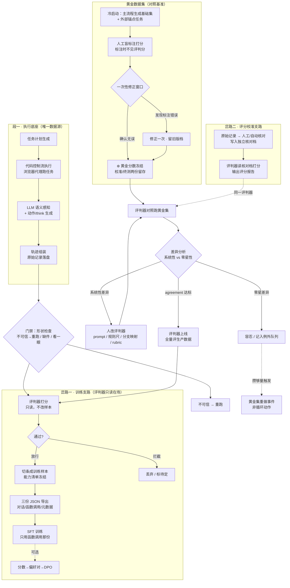

# 外部方案对账 · Agent 轨迹数据合成最终流程图

**外部方案**：用户 2026-10-14 提供的「# Agent 轨迹数据合成项目 · 最终流程图」（含段一执行底座、岔路一训练支路、岔路二评分校准支路、黄金集校准循环、四条铁律）

**对照对象**：`trajectory_pipeline/` v2 新树（截至 **2026-10-14** 快照，增量一~三十九，门禁 **2179 passed / 5 skipped**）

**性质**：**边界文档，本轮不改码**。只回答两个问题：

1. 方案要求的每个节点，靠**哪一段已落盘的数据 / 模块**承接？
2. 哪些节点现在**未闭环**，缺的是什么，补它要动哪里？

写它的理由与 `02-rubric与代码对齐.md` 同源——并排读的差异一旦不落纸面，下次改方案或改代码就会重新错位。

---

## 0. 项目交付边界声明

**已确认不纳入差异分析的两块**（与项目定位正交，不算差异）：

| 项 | 归属 | 理由 |
|---|---|---|
| **SFT 训练**（用 `P3 openai.json`） | 项目外 | 本项目定位是"合成数据"。P3 `openai.json` 已是合规训练框架输入（`tool_call_id` 关联按步派生，见 [架构总览 §模块 5](../01-架构总览.md)）。训练链是下游消费者的事。 |
| **可选 · 分数→偏好对→DPO** | 项目外 | 方案本身标"可选"；本项目不持有模型训练权，仅交付训练数据。 |

> **本项目交付边界** = P1 观察存档 + P2 训练样本 + P3 训练视图 + 评判器只读评分报告 + 黄金集校准状态。

---

## 1. 方案结构复述

### 1.1 总流程（用户提供的 mermaid）

### 1.2 四条铁律（防污染护栏）

| # | 铁律 | 防的污染 |
|---|---|---|
| 1 | 评判器对训练数据只有选择权，无写回权 | 评分判断污染训练内容 |
| 2 | 黄金分数一次修正窗口后冻结；补集必过人工闸 | 校准循环反向改答案（循环论证） |
| 3 | 人工标注盲标，不见评判分 | 锚定效应接通环 |
| 4 | 校准循环只改评判器和 rubric，人推开环 | 自动化收敛机制掩盖分歧 |

---

## 2. 一句话总览

| 维度 | 方案要求 | 当前实现 | 差异性质 |
|---|---|---|---|
| **段一 执行底座** | 任务生成 → 代码控制流 → LLM 感知 → 落盘 → 门禁 | 模块 1–5 全闭环，模块 4 接线，`check-archives` 三档 | ✅ **对齐** |
| **训练支路（数据侧）** | 评判器只读 → 切条 → 三视图 | 评判器只读 + 切条（决策单元）+ 三视图（messages/openai/meta）| ✅ **对齐**（数据交付闭环）|
| **评分校准支路** | 人工/自动核对 → 独立核对档 → 评分报告 | `review_queue` + xlsx + annotations.jsonl + `evaluation.cli --json`；INC37 验证器自动裁决 199 条 | ✅ **对齐** |
| **黄金集 校准循环** | 冷启动 → 盲标 → 冻结 → 评判器对照 → 改评判器 → 上线 | v3 已冻结（191 校准/103 持有），D-10 = 74.7%，70 条 systematic bias 未收敛 | ⚠️ **部分对齐**（循环能跑但未达 90% 阈值）|
| **四条铁律** | 评判器只写选择、黄金冻结、盲标、人推开环 | 全部 4 条都有纪律承载 | ✅ **对齐** |

**总评**：四条铁律 + 段一 + 训练支路数据侧 + 评分校准支路全对齐；差距集中在 **D-10 校准闭环未达上线阈值** + **LS 双向桥未启**。

---

## 3. 逐节点对账

### 3.1 段一 · 执行底座

| 节点 | 方案要求 | 当前实现 | 落点文件 | 差异 |
|---|---|---|---|---|
| 任务计划生成 | persona × skeleton × scenario 交叉采样 | `taskgen/` + `cli gen`，persona 六维 + 2 标记；W1 只跑 `single_title`（增量八 §⑦.1）| [`taskgen/`](../../taskgen/) | ✅ |
| 代码控制流执行 | 浏览器代理跑任务，每步抓取页面完整状态 | `executor/orchestrator.py` + obscura MCP，4 判断点 + `BRANCH_PRECONDITION` 前置事实核 | [`executor/orchestrator.py`](../../executor/orchestrator.py)、[`executor/branches.py`](../../executor/branches.py) | ✅ |
| LLM 语义感知 + 动作/think 生成 | 混合体（确定性事实 + LLM 语义补位）| `perception/llm_perceptor.py`（三条铁律：确定性优先 + 采集充分性预检 + ref 白名单校验）+ `rationale/writer.py`（执行期逐步生成）| [`perception/llm_perceptor.py`](../../perception/llm_perceptor.py)、[`rationale/`](../../rationale/) | ✅ |
| 轨迹组装 · 原始记录落盘 | 唯一数据源，正文全文不只摘要 | P1 `RunRecord` 平铺单文件 `output/pipeline/<task_id>__<hash>.json`；`max_chars=6000` 全文落盘（增量三 §D8）| [`executor/archive.py`](../../executor/archive.py) | ✅ |
| 门禁 · 形状三档 | 不可信 / 缺件 / 看一眼 | `executor/integrity.py` + `cli check-archives`，**三档 FATAL/DEGRADED/INFO** | [`executor/integrity.py`](../../executor/integrity.py) | ✅ |
| 门禁 · 矛盾拦截（同一站既有失败又有成功）| 方案明写：这种进训练集 = 教模型矛盾指令 | `quarantine.jsonl` 冻结机制（INC31，6 条 contract）+ `test_integrity.TestQuarantineURL`；v-wb.youku 8 份「成功存档」实测拦截（真相是 `subscription_wall`）| 同上 + [`05-现状与验收 §INC31`](../05-现状与验收.md) | ✅ **超出方案**（quarantine 是增量补充）|

**段一总评**：**对齐**。门禁机制甚至超出了方案要求。

---

### 3.2 岔路一 · 训练支路（数据侧）

> ⚠️ **修订**：SFT 训练 + 可选 DPO 不纳入（见 §0 项目交付边界声明）。

| 节点 | 方案要求 | 当前实现 | 落点文件 | 差异 |
|---|---|---|---|---|
| 评判器打分（只读，不改样本）| 只有"放行/拦截"两个按钮，**没有笔** | `SCORERS`（D-2/D-4/D-5/D-6 代码断言）+ `LLM_SCORERS`（D-3/D-9 LLM judge，`--include-llm-judge` 默认关）；评判器**只动 Sample 对象、不动 P1/P2 文件** | [`evaluation/scorers/`](../../evaluation/scorers/)、[`evaluation/cli.py`](../../evaluation/cli.py) | ✅ |
| 通过 → 切条成训练样本 | 能力清单冻结 | `assembler/schema.py`：`TOOL_SPECS` 冻结（既不反推 P1 也不 import `executor.actions.TOOLS`）；AST 守门 `TestNoExecutorImport` + `TestToolSpaceDrift` | [`assembler/schema.py`](../../assembler/schema.py) | ✅ |
| 三份 JSON 导出（对话/函数调用/元数据）| 三视图 | P3 `messages` / `openai` / `meta`，已落；`messages.json` 是降级形态（[架构总览 §模块 5 警示](../01-架构总览.md)），训练请用 `openai.json` | [`assembler/views.py`](../../assembler/views.py)、[`storage/`](../../storage/) | ✅ |
| SFT 训练 | 只用 `openai.json` | **项目外，不纳入差异** | — | — |
| 可选 · DPO | 分数→偏好对 | **项目外，不纳入差异** | — | — |

**训练支路（数据侧）总评**：**对齐**。本项目交付 = 评判器只读评分 + 切条 + 三视图，SFT/DPO 归属下游。

---

### 3.3 岔路二 · 评分校准支路

| 节点 | 方案要求 | 当前实现 | 落点文件 | 差异 |
|---|---|---|---|---|
| 原始记录 → 人工/自动核对 → 独立核对档 | 人工、自动两份队列文件物理隔离 | 人工：`review_queue.py` → `*.reviewed.json`（覆盖式，不并列）；自动：INC37 把 199 条 pending 经 L3+L4 验证器跑出 `auto-validator-l3l4-v1-{confirmed,weak_confirmed,flagged_mismatch,no_text_signal}` 四档裁决 | [`executor/review_queue.py`](../../executor/review_queue.py)、[`05-现状与验收 §INC37`](../05-现状与验收.md) | ✅ |
| 评判器读核对档打分 → 评分报告 | 不读原始档，只读核对档；输出是评分报告，不是"待分数数据集" | `evaluation/cli.py` 吃 `Sample` 对象（不直接吃 P2 dict）；`--json` 出评分 JSON | [`evaluation/cli.py`](../../evaluation/cli.py) | ✅ |
| 强制降级只改原始档不改核对档的坑 | 两边可能不一致 | `executor/downgrade.py` 模块 docstring 第 1 条：**只动原档，不动 `.reviewed.json`**；判据由调用方传；负样本池只减真在池里的 | [`executor/downgrade.py`](../../executor/downgrade.py)、[避坑指南 §1.5/§1.6](../02-避坑指南.md) | ✅ **关键纪律已守** |

**评分校准支路总评**：**对齐**，且降级纪律落实到 docstring。

---

### 3.4 黄金集 · 对照基准

| 节点 | 方案要求 | 当前实现 | 落点文件 | 差异 |
|---|---|---|---|---|
| 冷启动：主流程生成基础集 + 外部锚点 | 取自生产池，环路在时序上断开 | `candidates.jsonl` 从 P1 直接读，`source_kind` 区分 real / scout / ai-assisted-inc33 | [`evaluation/golden/data/candidates.jsonl`](../../evaluation/golden/data/candidates.jsonl) | ✅ |
| 人工盲标注打分 | 标注时不见评判分 | `reviewed_by=manual-review` 77 条 + xlsx 工作单独立；盲打（评分员没看 `dimension_scores`）| 仓库根 `黄金集人工复核工作单-23/254条.xlsx` + [05-现状与验收 §INC36](../05-现状与验收.md)（7 条 contract 守门）| ✅ |
| 一次性修正窗口 + 留旧版档 | 修正需留旧版档 | INC32 改 11 条 unreachable_hard → broken 时保留 `INC32_NOTE` 在 `note` 字段；`v2/agreement.json` 与 `v3/agreement.json` 各自留存 | [`evaluation/golden/data/v2/`](../../evaluation/golden/data/v2/)、[`v3/`](../../evaluation/golden/data/v3/) | ✅ |
| 冻结：黄金分数冻结 | 黄金分与循环动作解耦 | `builder freeze --version 3` 冻结 191 校准 / 103 持有；`versions.jsonl` 写 `label_schema_version`（1=11 类，2=15 类）| [`evaluation/golden/builder.py`](../../evaluation/golden/builder.py) | ✅ |
| 评判器对照跑黄金集 | 同一评判器，差异分析 | `builder agreement` 跑 D-10 一致率（口径 C，语义等价类一致），`alignment.EQUIV_CLASS` 唯一映射来源 | [`evaluation/golden/alignment.py`](../../evaluation/golden/alignment.py) | ✅ |
| 差异分析 → 系统性 vs 零星性 | 改评判器 vs 容忍 | INC32 已聚类（簇 1 type A/C / 簇 2 not_found 英文）；INC39 few-shot 注入点铺底 | [05-现状与验收 §INC32/§INC39](../05-现状与验收.md) | ⚠️ **部分对齐**（分析能力具备，人改 LLM prompt 未系统性推进）|
| 零星差异 → 容忍 / 记入例外队列 | 例外队列 | `quarantine.jsonl`（INC31，6 条 contract）—— 例外队列的雏形 | [`output/pipeline/quarantine.jsonl`](../../../output/pipeline/quarantine.jsonl) | ✅ |
| 达标 → 评判器上线 → 全量评生产数据 | 回到 B1 判断闸 | **❌ 未达**：v3 D-10 = 74.7% < 90% 阈值；systematic bias 70 条未收敛；评判器**未"上线"到生产链** | `evaluation/golden/builder.py::D10_THRESHOLD=0.90` | ⚠️ **差距显著** |
| 攒够量触发 → 黄金集重做事件 | 非循环动作 | D9 retest 队列（INC35，12 条 14 天后重打）—— test-retest 自相关，是校准循环的子事件；**完整的"重做事件"未启** | [`evaluation/golden/data/d9_retest_queue.jsonl`](../../evaluation/golden/data/d9_retest_queue.jsonl) | ⚠️ **部分对齐** |

**黄金集总评**：**机制全在，闭环未合**。当前是「能跑校准循环但未达上线阈值」的中间态，**不是结构缺陷**。

---

### 3.5 四条铁律（逐条对照）

| # | 铁律 | 防的污染 | 当前代码层守卫 | 文档层承诺 | 一致性 |
|---|---|---|---|---|---|
| 1 | 评判器对训练数据只有选择权，无写回权 | 评分判断污染训练内容 | `evaluation/cli.py` 独立入口；`SCORERS`/`LLM_SCORERS` 都是纯函数；不动 P1/P2 文件 | [架构总览 §模块 6 入口](../01-架构总览.md)、[端到端流程 §四](../06-端到端流程.md) | ✅ |
| 2 | 黄金分数一次修正窗口后冻结；补集必过人工闸 | 校准循环反向改答案（循环论证）| `builder freeze --version N` 后改 label 走新版本；`quarantine.jsonl` 处置而非修改历史；`label_schema_version` 跨版本核对 | [03-数据契约 §G1 黄金集契约](../03-数据契约.md)、[05-现状与验收 §INC32](../05-现状与验收.md) | ✅ |
| 3 | 人工标注盲标，不见评判分 | 锚定效应接通环 | `reviewed_by` manual-review 桶不与 `dimension_scores` 同步；xlsx 独立工作单 | [05-现状与验收 §INC36](../05-现状与验收.md)（7 条 contract 守门）| ✅ |
| 4 | 校准循环只改评判器和 rubric，人推开环 | 自动化收敛机制掩盖分歧 | INC32-39 全部是"人改尺子"模式（`branches.py` 关键词、`rule_perceptor.py` ACCESS_HINTS、`d9_scorer.py` few-shot），**没有自动改参入口** | 仓库根 [CLAUDE.md](../../../../CLAUDE.md)（红线"禁止投票/集成"）+ 全部增量档案章节 | ✅ |

**四条铁律总评**：**全对齐**，且文档纪律与代码守卫双向锁定。

---

## 4. 关键差异 / 风险点（按重要度排序）

### 4.1 🚨 D-10 一致率卡在 74.7%，未达 90% 上岗线

| 字段 | 值 |
|---|---|
| 方案要求 | v3 D-10 ≥ 90% 才"上线"，`D10_THRESHOLD=0.90` 已写 |
| 当前实数 | v3 D-10 = 74.7%（216/289），systematic bias 70 条 |
| 影响 | 评判器**未"上线"到生产链**——训练支路当前是"评判器备而不用"，靠 D-2/D-4/D-5/D-6 四个代码断言层机械过滤 |
| 处置路径（增量三十二已铺底）| 1) D-9 few-shot prompt 调优（INC39 已落注入点，**示例池待接入**——不能从 `ai-assisted-*` 桶挑，违反铁律 ③）；2) 重采集 70 条散落分支（簇 1 type A/C + NO_PLAY_RESOURCE→ACCESS_BLOCKED + SUCCESS→UNKNOWN）；3) 新分支黄金集（partial_free / login_required 仍 0 触发，b 路径追溯 17 条）|

### 4.2 🟡 LS 双向桥（`evaluation/ls_bridge/`）只有 `__init__.py`

| 字段 | 值 |
|---|---|
| 方案要求 | D6 改造为双向评估节点 + 冲突策略 + 台账扩展 |
| 当前实数 | 空包；L6 人工触发器未接——人工复核走 `cli review-queue` 手动拉 |
| 影响 | 方案"golden → LS → 回流"通道未启；人工环节靠 xlsx + `cli review` 离线完成 |
| 决策 | [05-现状与验收 §838](../05-现状与验收.md) 列为"不在本批范围"——是独立工程线 |

### 4.3 🟢 阶段 4 七层（L0–L5）独立于方案主流程图

| 字段 | 值 |
|---|---|
| 现状 | 方案流程图是**主流程**（段一→两岔路→校准循环），但项目实际多了一条**独立的浏览器媒体复核链**（`executor/probe/*` + `executor/review/*` + `executor/arbitration.py`）|
| 方案对比 | 方案未明写这条支路，但 INC37 验证器自动裁决 199 条**借用了 L3 + L4**——L3/L4 既服务阶段 4 也服务评分校准支路 |
| 差异性质 | **超出方案**而非偏差；与方案"校准循环只改评判器和 rubric"在边界上需要说明——L4 VLM 是评测器实现，不是"评判器"本身 |

---

## 5. 已超出的部分（方案要求之外但已落地的护栏）

| 护栏 | 出处 | 作用 |
|---|---|---|
| 门禁三档 FATAL/DEGRADED/INFO | 增量五 | 比方案"形状三档（不可信/缺件/看一眼）"更精细 |
| `quarantine.jsonl`（INC31）| 跨存档矛盾人工裁定 | 例外队列的雏形 + 跨存档矛盾冻结机制 |
| 阶段 4 七层 L0–L5 | 增量二十二~二十九 | 浏览器媒体复核独立链，可被校准循环借用 L3/L4 能力 |
| INC37 验证器自动裁决 199 条 | 增量三十七 | 把"人海战术扛 N 条"做长到"验证器扛大头，人只看低可信子集" |
| D9 retest 队列（INC35，12 条 14 天后重打）| 增量三十五 | test-retest 自相关的校准循环子事件 |

---

## 6. 阶段性对照表（与方案铁律对照）

| 方案铁律 | 当前代码层守卫 | 文档层承诺 | 一致性 |
|---|---|---|---|
| ① 评判器只读 | `evaluation/cli.py` 独立入口；`SCORERS` 纯函数；不动 P1/P2 文件 | [架构总览 §模块 6](../01-架构总览.md) | ✅ |
| ② 黄金冻结 | `builder freeze --version N`；`label_schema_version` 跨版本核对；`quarantine.jsonl` 处置而非修改历史 | [03-数据契约 §G1](../03-数据契约.md) | ✅ |
| ③ 盲标 | `reviewed_by` 4 个 manual-review 桶不与 `dimension_scores` 同步；xlsx 独立工作单 | [05-现状与验收 §INC36](../05-现状与验收.md) | ✅ |

---

## 7. 下一步行动清单（逼近方案目标态）

按重要度排：

1. **D-10 校准闭环**：v3 D-10 = 74.7% → 90%（2026-10-15 重采后投影 75.8%，见附录 C）。关键三件事——
   - D-9 few-shot 示例池接入（**不能从 `ai-assisted-*` 桶挑**，违反铁律 ③）——**已执行（INC40，2026-10-15）**：v1 池 6 条（anchored×4 / vague×1 / mild_hallucination×1）全部取自 manual-review 桶，verdict 逐条经 observation 全字段交叉核实；hindsight/systematic/misleading 无干净实例如实留空待 round=2；真实 LLM A/B 冒烟判定稳定、evidence 锚定质量提升，详见 [05-现状与验收 §INC40](../05-现状与验收.md)。**后续**：在带 rationale 存档上跑 `--include-llm-judge` 量测 D-9 verdict 分布（INC40 联动事项 #2）
   - 70 条散落分支重采集或新分支黄金集构造——**已执行（附录 C）**：降级 27/30 恢复，采集层修复验证通过但非充分
   - b 路径追溯 `login_wall_or_blocked` 17 条（partial_free / login_required 仍 0 触发）
2. **LS 双向桥**：独立工程线，与校准闭环正交——不在主批范围
3. **阶段 4 七层补完**：L6 人工触发器 + L7 LS 回流（与 #2 重叠）

---

## 8. 一句话总结

**方案与实现的差距集中在两件事**：

1. **校准循环未闭环**——D-10 74.7% vs 阈值 90%，评判器备而未用（**关键路径**：few-shot 调优 + 重采集 + 新分支黄金集）
2. **LS 双向桥未建**——`evaluation/ls_bridge/` 是空包，人工环节离线完成（独立工程线，不在主批范围）

**已对齐的硬骨头**：铁律 4 条 + 主流程段一 + 训练支路数据侧 + 评分校准支路 + 黄金集前 6 步——全部已落地。

**已超出的部分**：门禁三档 + `quarantine.jsonl` + 阶段 4 七层 L0–L5——实战中增量补出来的护栏。

**项目边界外**：SFT 训练 + DPO（明确不纳入差异分析）。

---

## 9. 相关文档

| 文档 | 内容 |
|---|---|
| [`01-架构总览.md`](../01-架构总览.md) | 模块地图 + 依赖方向、控制流与四个判断点、失败分支全集、感知层七不变式 |
| [`02-避坑指南.md`](../02-避坑指南.md) | 9 类 72 条，症状写成终端里真正会看到的那句话 |
| [`03-数据契约.md`](../03-数据契约.md) | P1/P2/P3 契约表、`steps[]` 三条口径、G1 黄金集契约 |
| [`05-现状与验收.md`](../05-现状与验收.md) | 跑到哪儿了、接下来做什么（**会过时，用前先重跑命令核对**）|
| [`06-端到端流程.md`](../06-端到端流程.md) | 一条数据从骨架走到训练样本的完整路径 |
| [`02-rubric与代码对齐.md`](02-rubric与代码对齐.md) | rubric 逐维度 ↔ 代码对齐账（**本文与它同源——边界文档，本轮不改码**）|
| [`03-rubric修订与实施方案.md`](03-rubric修订与实施方案.md) | rubric v1.1 逐条改稿清单 + 五个代码变更 |
| [`10-judge接入方案.md`](10-judge接入方案.md) | LLM judge 接入方案三步走（D-3 / D-9 / D-10 扩维）|

<!-- 文档目的：与 02-rubric与代码对齐.md 同源——并排读的对账结论一旦不落纸面，下次改方案或改代码就会重新错位。 -->

---

## 附录 A · H1-α 复盘（PAYWALL recall 0.20 → 0.70 尝试失败）

**背景**：2026-10-14 用户选 H1-α「PAYWALL recall 修复」作为高优缺口项的执行目标。v3 D-10 74.7%，PAYWALL 单类 TP=7 FP=2 FN=28 F1=0.32（35 条 PAYWALL 黄金样本只判对 7 条）。

**方案**：在 `perception/llm_perceptor.py` 加 `_strong_paywall_signal(obs.body_text)` 判据，与 `executor/branches.py` 的 `STRONG_PAYWALL_KEYWORDS` 同源——
- `decide()` 主入口：`video_tag_count >= 1` 闸门前置强信号检查，命中则旁路闸门、让 `_player_ok` 接管
- `_player_ok`：LLM 答 True 但强信号命中 → 强制 `answer=False`；试看类关键词 + 强信号 → 强制 `paywall_type="preview"`

**落码 → 跑诊断 → 撤回**：三个动作串行做完后**整体撤回**（无任何代码留盘）。诊断脚本与契约测试一并删除。

### 撤回原因（净改善 = 修 FN − 误伤 SUCCESS）

| 判据口径 | 修 PAYWALL FN | 误伤 SUCCESS | 净改善 |
|---|---|---|---|
| 宽松（≥1强+≥1弱 / ≥2强 / ≥1强+价格）| 4/28 | 6/36 | **−2** |
| 收紧（≥2强 / ≥1强+价格）| 3/28 | 4/36 | **−1** |

**两条判据口径下，H1-α 净改善都是负数**——D-10 不升反降。

### 真根因（24/28 FN 任何关键词判据都修不动）

| 形态 | 数量（粗数）| evidence 形态 | 修复路径不在判据层 |
|---|---|---|---|
| **采集降级** | 多条 | `采集降级（['body_text']），证据不完整，不判` | perceptor 没看到 body_text，关键词自然命中不到 |
| **记账降级** | 多条 | `[记账降级] 本该记 component_unverified，但同页守卫不通过——前置事实不成立` | 标签不挂，金标 PAYWALL 但 code 落 unresolved |
| **evidence 简写丢信号** | 散落 | evidence 写「页面显示『发生了错误』」，但原 body_text 实际含「VIP 会员专享」 | LLM 总结时把付费信号压缩掉了，回查 evidence 找不到 |

### 误伤样本特征（6 条 SUCCESS 黄金被宽松判据命中）

evidence 形态同形：「续费会员」+「开通」同现于导航栏 / 页脚 CTA，**不是**真付费墙；人工裁定 SUCCESS。判据把「强词 + 弱词」共现视作信号，在 nav-bar 高频短语下过激。

### 教训（避免再踩）

1. **判据级修复是表层，结构级问题在采集层 / 记账层**——下次分析 per_class 漏判必须先看 evidence 全文分布，再判断要不要动判据
2. **D-10 提升路径排序**：① 消除 body_text 采集降级（让判据有机会见到信号） ② 修正记账降级的同页守卫边界 ③ 让 evidence 完整保留付费信号（不简写）→ **判据级修复排在第三之后**
3. **黄金集 evidence 字符串不等于真实 body_text**——离线诊断时务必区分；evidence 简写会让所有关键词判据都低估命中数

> 本附录作为"为什么 D-10 74.7% 不靠判据修复就能上 90%"的备忘。

---

## 附录 B · H1-β 复盘（采集降级 sufficiency 闸门修复尝试失败）

**背景**：2026-10-14 用户继 H1-α 撤回后选 H1-β「采集降级」。H1-α 复盘指出 24/28 PAYWALL FN 来自采集降级 / 记账降级 / evidence 简写，H1-β 目标为「消除 body_text 采集降级」。

### 量化（v3 黄金集 294 条 site 级）

- 30 条样本 evidence 含 `采集降级`，**全部**在 `site.find_play_control` 题上：
  - 27 条 `['body_text']` 降级
  - 3 条 `['body_mojibake']` 降级
- 30 条 D-10 一致/不一致：17/13
  - 13 条不一致中：**8 条 PAYWALL FN**（金标 subscription_wall，code 落 unresolved）+ 2 REACH_FAIL + 1 NOT_PLAY_SITE + 1 TRAILER + 1 SUCCESS

### 22 个 P1 存档现场核查（33 条 site/player 访问级 body_text 降级）

| 其它字段状态 | 数量 | 占比 | 可走路径 |
|---|---|---|---|
| 有 elements 可用 | 3 | 9.1% | `_find_play_control` 词表接管 |
| 仅 video_tag_count/iframe_count | 26 | 78.8% | 主入口 video 闸门接管（**直接 True**）|
| 全部为空 | 4 | 12.1% | 仍拦，采集本身需修 |

### 方案 → 撤回

**方案**：在 `_sufficiency` 把 `if obs.degraded: return ...` 改为「**只**当 degraded 集合仅含 `body_text`/`body_mojibake` + 无 mojibake + 至少一项兜底信号（elements/video/iframe）非空时放过闸门」。

**落码 → 推演 FP/FN → 撤回**：
- 26 条仅 video 兜底 → 走主入口 video_tag_count 闸门**直接 True → success**——而这 26 条里 6 条金标 PAYWALL + 2 条 REACH_FAIL + 1 条 NOT_PLAY_SITE + 1 条 TRAILER——**全被改判 SUCCESS**。D-10 不一致数 26 → 不一致数 26（success ↔ PAYWALL/REACH_FAIL/NOT_PLAY_SITE/TRAILER 仍不等价），**净改善 = 0**。
- 3 条 elements 兜底 → 词表可能找到也可能没找到 ref——金标里有 NOT_PLAY_SITE 等，**可能制造 FP**。
- 4 条全空 → 仍拦截，0 改善。

**根因**：`body_text` 降级意味着**付费墙信号（VIP/订阅/续费 + 价格）丢了**——这不是 sufficiency 闸门能救的，是**采集本身**得能采到 body_text。放过闸门只是把"采集失败"从 unresolved 改写成 success，**信号没回来**。

### 真根因（与 H1-α 复盘互证）

| 层级 | 错位 |
|---|---|
| **采集层** | `obscura_driver.py:163-170` 的 `browser_evaluate` 失败时 `degraded.append("body_text")`——`document.body.innerText` 在 JS-heavy 站（iqiyi / ixigua / sohu / bilibili）偶发返回空或失败 |
| **sufficiency 闸门** | `obs.degraded` 一刀切拦截，**没有**为"只有 body_text 降级但 elements/video 仍有效"开窗 |
| **判据层** | 任何关键词判据在 body_text 缺失时都命中不到（强付费墙信号就在 body_text 里） |

### 教训

1. **采集层失败 → sufficiency 拦截 → perceptor 退回 unresolved 是正确链条**——这条链不能断。改 sufficiency 等于把"采集失败"从 unresolved 改写成 success，制造的是**对侧的 FP**。
2. **D-10 提升真正可行的路径**：改 obscura 让 `browser_evaluate` 更稳地拿到 innerText（fallback 到 `document.body.textContent`、或多等一个 wait）；这必须端到端跑（需 obscura 真实环境）才能验证。
3. **H1-β 的诊断价值**：让 30 条降级样本的"其它字段有效性"显形——26 条仅 video 兜底揭示了「**主入口 video 闸门存在**但 **PAYWALL FN 不被它救**」的根因（这是 H1-α 错过的角度）。

> 本附录作为"采集层降级不在判据 / sufficiency 层修，必须改 obscura"的备忘。
>
> **后续（2026-10-15）**：该修复已落码（`obscura_driver.py` 的 `TEXT_CONTENT_EXPR` fallback）并经附录 C 端到端验证——降级 27/30 恢复。

---

## 附录 C · H1-γ 复盘（端到端重采集：采集层修复验证 + 感知层瓶颈确证）

**背景**：2026-10-15，H1-β 指认的采集层修复（obscura innerText → textContent fallback）落码后，执行端到端重采集，实测回答"降级消除能拉动 D-10 多少"。

**目标集**：v3 黄金集 289 条站点级中，D-10 不一致 73 条 ∪ 采集降级 30 条（交集 13）= **90 行并集**，涉及 27 个 P1 存档、75 个唯一 (task_id, url) 对。域名集中在 iqiyi(17)/bilibili(15)/v.qq(6)——正是附录 B 定位的 JS 重站降级区。

### 执行过程

| 步骤 | 结果 |
|---|---|
| 试点：E006 全链重跑（`cli run`，同 query 同引擎）| 暴露**搜索漂移**：bing 返回全新候选（剑桥词典/IMDb「Trap」），与旧黄金行 7 个 URL **零命中**——「重跑同 query」不能作为重采对账手段 |
| 改道：URL 直访（复用主链 `visit_site`，感知链 obscura+LLM 一行未变，仅候选不从搜索来）| 75/75 完成，命中 80/90 行；未命中 10 = select 级 8（`select.play_sites` 判定发生在搜索页，直访不等价，按设计跳过）+ 访问级 2（1 条 baidu `/link` 密文中转、1 条 v.qq）|

### 量化结果

| 指标 | 值 |
|---|---|
| 采集降级恢复 | **27/30**（新 evidence 不再含「采集降级」）—— textContent fallback 端到端验证通过 |
| 分支修复（不一致→一致）| 5 |
| 分支反转（一致→不一致）| 2（如 unresolved → unreachable_hard）|
| **D-10 投影** | **74.7% → 75.8%**（216→219/289），距 90% 上岗线仍差 14.2pp |
| 新分支分布（命中 80 行）| unresolved **40**、login_wall_or_blocked 11、no_play_control 8、blocked 6、unreachable_hard 5、component_unverified 4、success 2、player_unverified 2、broken 1、subscription_wall 1 |

### 真根因（与附录 A/B 互证，三层排查链就此闭环）

| 层级 | 状态 | 证据 |
|---|---|---|
| 采集层（附录 B 指认）| ✅ 已修 | 降级 27/30 恢复——付费墙信号回来了 |
| 记账层 | 基本无事 | 分支反转仅 2 条 |
| **感知层** | ❌ **确证为当前主瓶颈** | body_text 拿到了但 LLM 仍判 unresolved：最大簇「金标 subscription_wall → 代码 unresolved」19 条中重采**仅修复 1 条**——perceptor 看得到信号却判不出 |

### 教训

1. **搜索漂移是重采的结构性风险**——同 query 重跑无法回到同一页面；URL 直访（感知链不变、只换候选来源）是唯一可靠的对照重采方式。
2. **采集层修复是必要非充分**——+1.1pp 的实测把「消 body_text 降级」从 D-10 提升路径的**首位降级为前置条件**。
3. **感知层是 LLM 判定本身，不是 H1-α 的关键词判据层**（那已被附录 A 证伪）——属于 INC39 D-9 few-shot 的领地；且本次直采产出（金标 subscription_wall 的页面 + 已恢复的 body_text）就是 few-shot 的天然素材（选 manual-review 桶，不违反铁律 ③）。
4. **投影 ≠ 正式数字**——要转正需走 INC32 追溯先例：新 code.branch 写回冻结文件 → freeze v7 → `agreement --version 7`；金标侧一行不动。

**落盘产物**（2026-10-20 迁入 `trajectory_pipeline/research/recollect/`）：
`manifest.json`（90 行清单）、`outcomes.jsonl`（75 对新判定）、`measure.py`（可重跑的投影脚本）、
试点新档 `output/pipeline/E006__9cef9a3b.json`。本附录全部结论（D-10 投影 75.8%、
降级恢复 27/30 等）均从上述**落盘文件**计算得出，不依赖任何运行中的进程——
重跑 `research/recollect/measure.py` 可随时复算（在仓库根执行）。

> 本附录作为「采集层已修、感知层接棒」的实测备忘——D-10 上 90% 的下一手是 D-9 few-shot，不再是采集。

